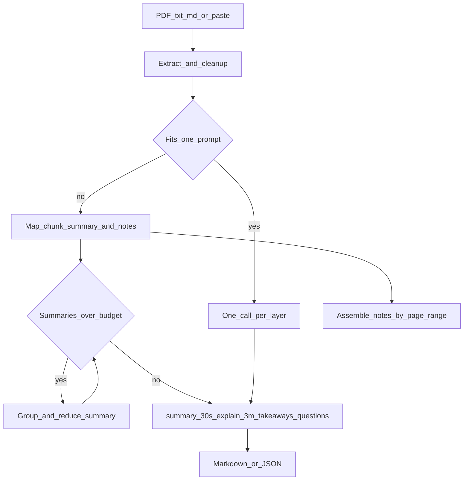
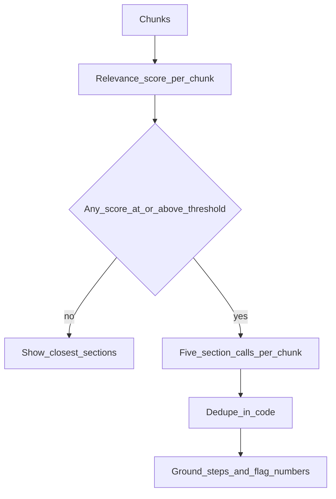

# tldr-everything

The Reading Debt Killer. Turn a PDF or a long paste into a 30-second summary, a 3-minute explanation, and page-cited notes, or ask for only the parts that match a goal.

[](https://github.com/your-org/tldr-everything/actions)
[](LICENSE)
[](pyproject.toml)

The code in this repository is MIT. The default model weights are not. See [Model licensing](#model-licensing).

## Demo

A GIF belongs in [`docs/screenshots/`](docs/screenshots/README.md). Record the Streamlit app on `examples/docker-vps.md`, save it as `docs/screenshots/demo.gif`, and drop this line in once the file exists:

```markdown

```

Until then, the [sample output](examples/sample-output.md) below is the shape of a result.

## The problem

Tutorials, docs, papers, and long articles pile up unread. Opening one means paying the whole reading cost before you know if it answers the question you saved it for.

tldr-everything cuts that cost into layers. Each layer is its own short model call, because the default model is small and does one job better than five.

**30-second summary** (about 60–90 words). The claim and the outcome.

**3-minute explanation** (about 350–500 words). Why it works, how it works, and the jargon.

**Detailed notes.** Bullets, definitions, and numbers taken per chunk, grouped by page, with a short list of takeaways and questions the document leaves open.

**Tell me only what I need.** You state a goal. Chunks that score below the threshold are dropped. From the rest you get prerequisites, practical steps, the pages that matter, what to skip, and the gotchas. If nothing scores high enough, the tool says the document does not cover the goal and shows the closest sections. It does not invent a procedure.

From [examples/docker-vps.md](examples/docker-vps.md), goal "I want to deploy this with Docker on a VPS", the practical steps look like this (full illustration in [examples/sample-output.md](examples/sample-output.md)):

```bash
sudo apt-get update
sudo apt-get install -y docker.io
docker compose up -d
```

A fenced command that was not in the source is dropped. An inline command that was not in the source is marked `[unverified]`.

## Quickstart

You need Python 3.10+ and [Ollama](https://ollama.com). The model runs locally. Document text stays on the machine unless you point `LLM_BASE_URL` at a remote server.

### Local

```bash
python -m venv .venv && . .venv/bin/activate && python -m pip install -e .
ollama pull qwen2.5:3b
make model
export LLM_MODEL=tldr-qwen
tldr ui
```

Windows (PowerShell), if you do not have Make:

```powershell
python -m venv .venv; .\.venv\Scripts\Activate.ps1; python -m pip install -e .
ollama pull qwen2.5:3b
ollama create tldr-qwen -f ollama/Modelfile
$env:LLM_MODEL = "tldr-qwen"
tldr ui
```

`make model` builds `tldr-qwen` with a context window of 8192. Without that, Ollama can silently truncate prompts. Details are in [docs/small-models.md](docs/small-models.md). You can instead start Ollama with `OLLAMA_CONTEXT_LENGTH=8192` and leave `LLM_MODEL=qwen2.5:3b`.

### Docker

```bash
docker compose up --build
```

Wait until the `model-init` service finishes pulling `qwen2.5:3b` and creating `tldr-qwen`. Then open `http://localhost:8501`. The first start is slow because it downloads the weights.

### CLI

```bash
tldr summarize examples/docker-vps.md --layer 30s
tldr goal examples/docker-vps.md --goal "I want to deploy this with Docker on a VPS"
tldr summarize notes.pdf --out notes.md --json
tldr ui
```

`--layer` accepts `30s`, `3m`, `notes`, or `all`. `--text` reads a string instead of a file. `--model` and `--base-url` override the environment for one run. `--verbose` logs call types and timings, never the document.

## Configuration

Copy `.env.example` to `.env`. Every variable is listed there.

| Variable | Default | Role |
| --- | --- | --- |
| `LLM_BASE_URL` | `http://localhost:11434/v1` | OpenAI-compatible endpoint |
| `LLM_API_KEY` | `ollama` | Any non-empty string for Ollama |
| `LLM_MODEL` | `qwen2.5:3b` | Use `tldr-qwen` after `make model` |
| `LLM_MAX_CONTEXT_TOKENS` | `8192` | Budget the pipeline plans against |
| `LLM_TEMPERATURE` | `0.2` | Low, so the small model stays put |
| `LLM_TOP_P` | `0.9` | Nucleus sampling |
| `LLM_CONCURRENCY` | `2` | Map-call threads. Keep this at 1 or 2 on CPU |
| `CHUNK_TOKENS` | `1500` | Target chunk size, characters/4 |
| `CHUNK_OVERLAP_TOKENS` | `150` | Overlap, best effort on paragraph boundaries |
| `MAX_PAGES` | `80` | Refuse larger PDFs, with a minute estimate |
| `MAX_CHARS` | `400000` | Same idea for pasted text |
| `GOAL_RELEVANCE_THRESHOLD` | `2` | Drop chunks scored below this (0–5) |
| `LANGUAGE` | `English` | Output language |

Detail levels (`brief`, `normal`, `deep`) only change the word targets. `normal` is 60–90 and 350–500. The tolerant bands that trigger a retry are wider (40–130 and 250–650).

Reading time uses 220 words per minute. The "about N minutes" warning before a run assumes 30 seconds per call until a real latency exists.

### Hardware

A 3B model is comfortable on 8 GB of RAM, including CPU-only. Expect roughly 20–45 seconds per map call on CPU and roughly 5–15 seconds on a small GPU. Those numbers are approximate. The progress bar replaces them with the average it has actually seen.

A 7B model wants about 16 GB. It is a drop-in upgrade: set `LLM_MODEL` and, if the context window grew, raise `CHUNK_TOKENS` toward `min(4000, context * 0.2)`.

LM Studio, vLLM, and OpenRouter settings are in [docs/small-models.md](docs/small-models.md).

## Working with a small model

Qwen2.5-3B is good at a short summary and at pulling notes out of one chunk. It is weak at nuanced argument, dense math, long reasoning, and languages other than English. A non-English `LANGUAGE` is supported, and the quality will be lower. The UI says so.

The pipeline compensates:

- one job per call, with a short prompt and a fixed shape
- small chunks and a recursive reduce so a prompt is never larger than the budget
- a length retry, then a warning if the text is still the wrong size
- grounding for commands and a flag for numbers the source never stated

Upgrading the model is the quality lever. `qwen2.5:7b-instruct` and `llama3.2:3b` are the documented alternatives. Nothing else in the pipeline has to change.

## How a document moves



Goal mode:



More detail is in [docs/architecture.md](docs/architecture.md) and [docs/prompts.md](docs/prompts.md).

## Privacy

Nothing is sent anywhere in the default setup. Ollama listens on localhost. The CLI and the UI warn when `LLM_BASE_URL` is not a local address, including when you use OpenRouter. Logs record call types, token estimates, and timings. They do not record the document.

## Limits

- No OCR. A scanned PDF produces a clear error instead of an empty summary.
- Encrypted PDFs must be exported without a password first.
- Quality follows the model. A 3B summary can miss a nuance or flag a number the checker is unsure about.
- The context window is a hard ceiling. Set it honestly. Silent truncation is worse than a smaller chunk.
- Very large files are refused at `MAX_PAGES` / `MAX_CHARS`, with a rough minute estimate and the variable to raise.

## Roadmap

OCR, URL input, Obsidian and Notion export, a browser extension, multi-document question answering, and an optional embedding pre-filter before the relevance calls.

## Development

```bash
python -m pip install -e ".[dev]"
python -m pytest
python -m ruff check .
python -m ruff format --check .
python -m mypy
```

The test suite mocks the LLM. To score a live local model:

```bash
python evals/run_eval.py
python -m pytest -m slow -o addopts=
```

The slow test is skipped by default and is not run in CI. If Ollama is down it skips instead of failing.

See [CONTRIBUTING.md](CONTRIBUTING.md).

## Model licensing

This repository is [MIT](LICENSE). Model weights have their own licenses.

Qwen2.5-3B is released under the Qwen Research License, not Apache 2.0. Check the current model card before commercial use. Qwen2.5-7B-Instruct is Apache 2.0. Llama 3.2 weights use the Llama license. Confirm the card for the exact tag you pull. This note is not legal advice.

## Defaults we picked

A few choices were not pinned down by the problem statement:

- The environment default model is `qwen2.5:3b`. After `make model`, set `LLM_MODEL=tldr-qwen`.
- Tokens are characters divided by 4. No tokenizer dependency.
- Detail level only tightens or loosens word targets.
- Practical-step fences that are not in the source are dropped. Inline commands are marked `[unverified]`. Numbers are flagged, not deleted.
- Overlap follows paragraph boundaries and always moves forward.
- Files over the page or character cap are refused rather than started.
- Pre-run time estimates use 30 seconds per call until a real measurement exists.

## Acknowledgements

Qwen, Ollama, PyMuPDF, Streamlit, and Typer. And everyone with a folder of articles they still mean to read.

## License

MIT. See [LICENSE](LICENSE).
