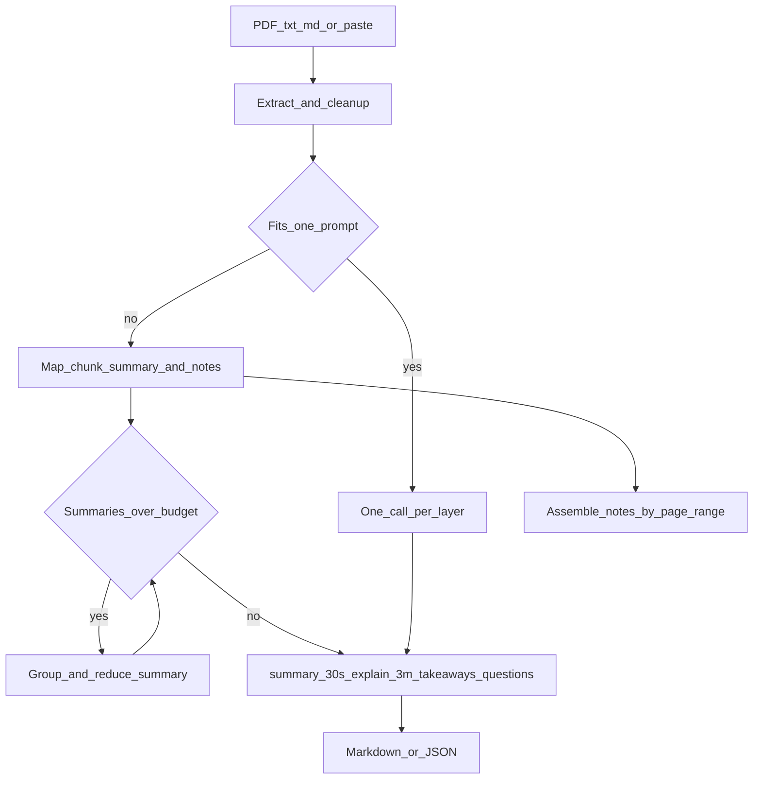
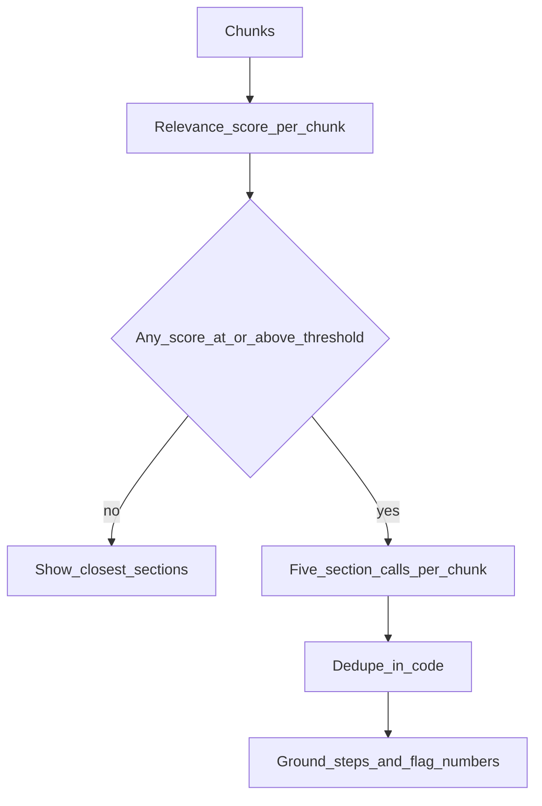

# Architecture

tldr-everything turns a PDF or a paste into layered reading notes. The model
does one small job per call. Python decides what fits in the context window,
how long a summary is, and whether a command actually appeared in the source.

Goal mode is a separate path. It never asks the model to invent steps for a
goal the document does not cover.

## Modules

| Module | Role |
| --- | --- |
| `config.py` | Environment settings and per-call output caps |
| `extract.py` | PyMuPDF and text loaders, cleanup, size limits |
| `chunking.py` | Overlapping chunks with page ranges |
| `prompts.py` | One short prompt per call type |
| `llm.py` | OpenAI-compatible client, retries, error text |
| `postprocess.py` | Chatter stripping, scores, length, grounding |
| `pipeline.py` | Single-pass, map, recursive reduce, both modes |
| `export.py` | Markdown and JSON |
| `cli.py` / `ui.py` | Typer and Streamlit |

## What the code checks

- Prompt tokens plus the output cap plus a 256-token margin must sit under
  `LLM_MAX_CONTEXT_TOKENS`. Tokens are `len(text) // 4`.
- The 30-second summary should land in a tolerant band (40–130 words at the
  normal detail level). The 3-minute explanation uses 250–650. Outside that
  band, the pipeline retries once with a stricter length line, then keeps the
  text and sets a `length` warning.
- Fenced code in Practical steps must appear, ignoring whitespace differences,
  in the source. Otherwise the block is dropped. Inline commands that are
  missing are marked `[unverified]`.
- Versions (`1.2.3`) and numbers of three digits or more that never occur in
  the source are flagged and left in the text.
- Document text is not written to the log.

## Concurrency and progress

Map calls use a thread pool capped by `LLM_CONCURRENCY` (default 2). The
progress callback reports completed calls and an ETA from the mean latency so
far. Final-layer calls can stream tokens to the UI.
